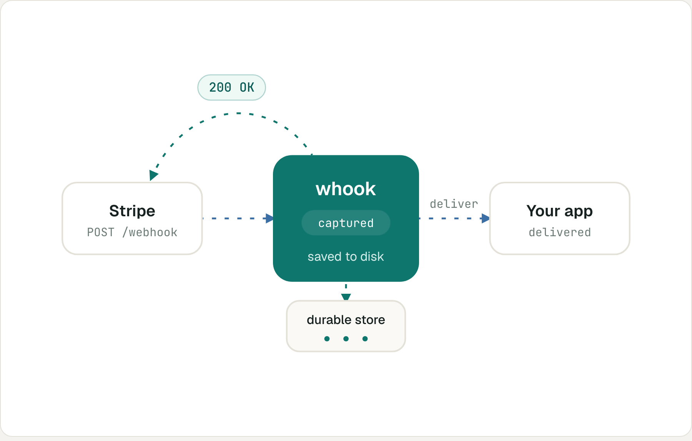
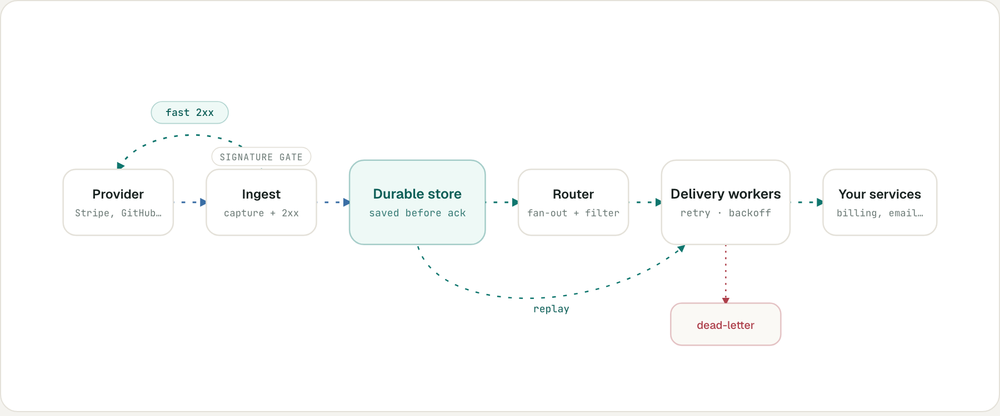
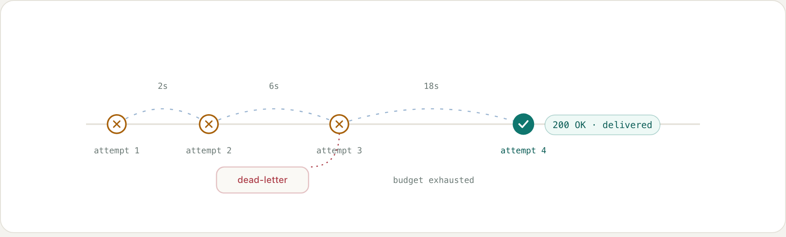
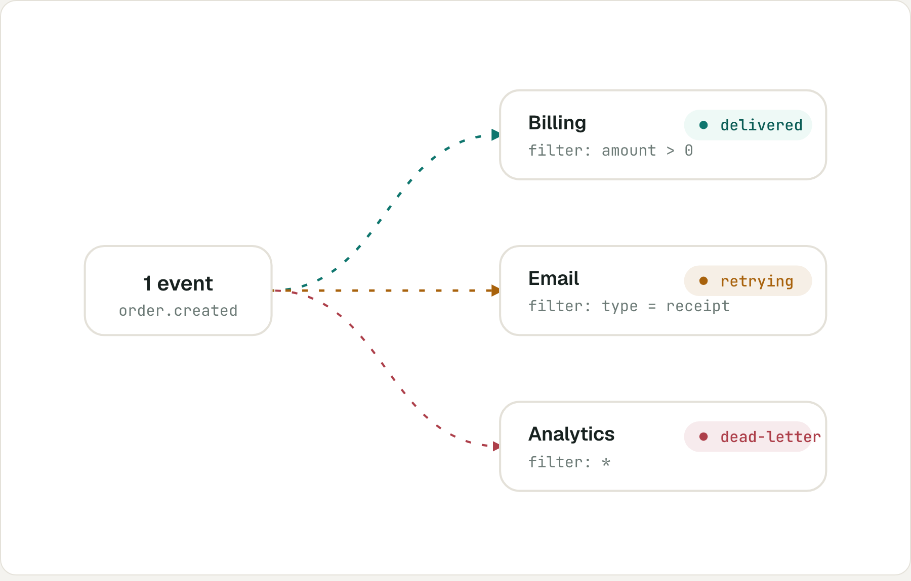

<div align="center">

# whook

**A self-hostable gateway that captures, retries, and replays inbound webhooks.**

[](https://github.com/edaywalid/whook/actions/workflows/ci.yml)
&nbsp;[](https://github.com/edaywalid/whook/actions/workflows/docker.yml)
&nbsp;
&nbsp;
&nbsp;[](https://whook-gateway.netlify.app)

[Getting started](#getting-started) · [Documentation](docs/) · [Live demo](https://whook-gateway.netlify.app) · [Contributing](CONTRIBUTING.md)

</div>

<br />

whook sits in front of your application. Providers point at it instead of at you.
It captures every inbound webhook the instant it arrives, returns a fast 2xx so
the provider is happy, then forwards the event to one or more destinations with
automatic retries. Every request is stored durably, so you can list, inspect, and
replay anything that came in.

<picture>
  <source media="(prefers-color-scheme: dark)" srcset="docs/diagrams/assets/capture-flow-dark.png">
  
</picture>

**What you get**

- Durable capture before the provider is acknowledged, so no event is ever lost.
- Exponential-backoff retries with a budget, then dead-letter for what never lands.
- Fan-out to many destinations, each with its own filter, retries, and status.
- A durable record of every request, queryable and replayable from an API or UI.
- Pluggable signature verification (Stripe, GitHub, Shopify, Slack, Linear), idempotent capture, metrics.
- One static Go binary. SQLite built in, Postgres when you outgrow it.

## Table of contents

- [The problem](#the-problem)
- [How it works](#how-it-works)
- [Getting started](#getting-started)
- [Documentation](#documentation)
- [Tech stack](#tech-stack)
- [Contributing](#contributing)
- [License](#license)

## The problem

Services like Stripe, GitHub, and Shopify notify you by sending an HTTP POST to a
URL you give them. A payment succeeds, a pull request opens, an order is placed,
and they POST the details to your server. That POST is the webhook, and it arrives
exactly once, at a moment you do not control.

Point a provider straight at your application and it is fragile:

- If your app is down, deploying, or briefly crashing when the webhook lands, the
  event is lost. Many providers retry weakly or not at all.
- When processing fails, the original request is already gone, so debugging is blind.
- A provider usually allows one destination URL, but billing, email, and analytics
  may all need the same event, which forces hand-written fan-out glue.
- There is no simple way to replay a past webhook to reproduce a bug or recover.

<picture>
  <source media="(prefers-color-scheme: dark)" srcset="docs/diagrams/assets/without-whook-dark.png">
  
</picture>

## How it works

Capture is decoupled from delivery. An inbound request is saved durably **before**
it is acknowledged. Delivery happens afterward, on whook's own schedule, so a
destination being down never costs you an event.

<picture>
  <source media="(prefers-color-scheme: dark)" srcset="docs/diagrams/assets/architecture-dark.png">
  
</picture>

**Reliable delivery.** A failed delivery is retried on a deterministic exponential
schedule (a 429 honors its `Retry-After`). When the retry budget is exhausted the
delivery is dead-lettered, so it stops consuming resources and becomes visible for
inspection and replay.

<picture>
  <source media="(prefers-color-scheme: dark)" srcset="docs/diagrams/assets/retry-timeline-dark.png">
  
</picture>

**Fan-out.** One captured event resolves to every matching destination as an
independent delivery track, each with its own filter and status. A failing
destination never blocks the others.

<picture>
  <source media="(prefers-color-scheme: dark)" srcset="docs/diagrams/assets/fan-out-dark.png">
  
</picture>

## Getting started

### Install

**Docker** (prebuilt multi-arch image, recommended):

```sh
docker run -p 8080:8080 -v whook-data:/data ghcr.io/edaywalid/whook:latest
```

**Docker Compose** (builds the full stack from source):

```sh
cp .env.example .env   # set WHOOK_ADMIN_TOKEN and WHOOK_SECRET_KEY
docker compose up --build -d
```

**Prebuilt binary** (Linux, macOS, Windows on amd64 and arm64):

Download the binary for your platform from the
[latest release](https://github.com/edaywalid/whook/releases/latest), then run it.

**From source** (Go 1.25+):

```sh
go install github.com/edaywalid/whook/cmd/whook@latest
whook
```

The gateway listens on `http://localhost:8080` and stores events in a local SQLite
file by default. See [Deployment](docs/deployment.md) for Postgres and scaling.

### Send your first webhook

```sh
# 1. Register a source (the provider integration)
curl -X POST localhost:8080/sources -d '{"name":"stripe"}'

# 2. Point it at one or more destinations
curl -X POST localhost:8080/destinations \
  -d '{"source":"stripe","url":"https://your-app.example.com/webhooks"}'

# 3. Send a webhook to the gateway
curl -X POST localhost:8080/ingest/stripe \
  -H 'Content-Type: application/json' \
  -d '{"type":"payment.succeeded","amount":4900}'

# 4. Inspect captured events
curl localhost:8080/events
```

Open `http://localhost:8080/ui` for the dashboard: it lists events, links to a
per-event detail page (payload, delivery state, attempt history, replay button),
and has a dead-letter view.

## Documentation

- **[Configuration](docs/configuration.md)**: every environment variable, auth, secrets, retention, and rate limiting.
- **[HTTP API](docs/http-api.md)**: endpoints, sources, destinations, the filter spec, and replay.
- **[Deployment](docs/deployment.md)**: Docker, the GHCR image, Compose, building from source, and Postgres.
- **[Contributing](CONTRIBUTING.md)**: how to build, test, and submit changes.

## Tech stack

- Go, single static binary
- SQLite by default (pure-Go driver, no cgo) or Postgres for scale, behind one storage interface
- Standard library HTTP, server-rendered dashboard
- dbmate-authored migrations, embedded and applied on startup
- Landing page in `web/` (TanStack Start, React 19, deployed at [whook-gateway.netlify.app](https://whook-gateway.netlify.app))

## Contributing

Issues and pull requests are welcome. See [CONTRIBUTING.md](CONTRIBUTING.md) for
how to build, run the tests (including the Postgres integration tests), and the
migration and code-style conventions.

## License

[MIT](LICENSE)
