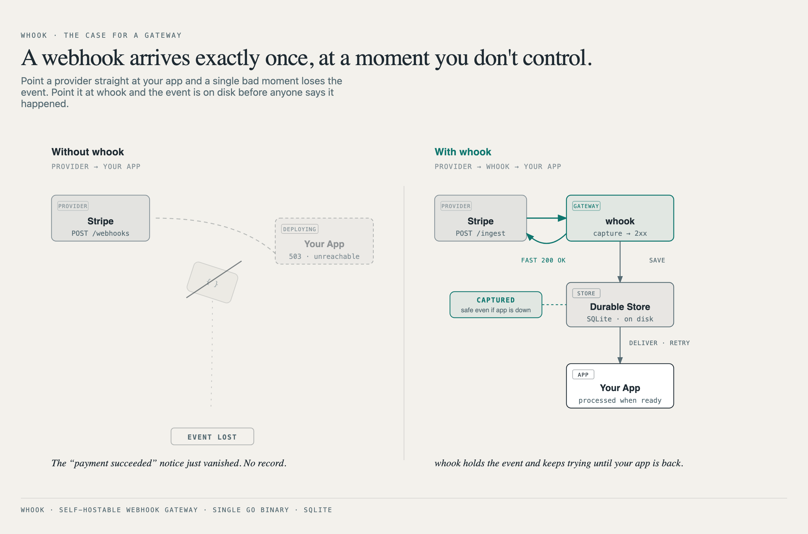
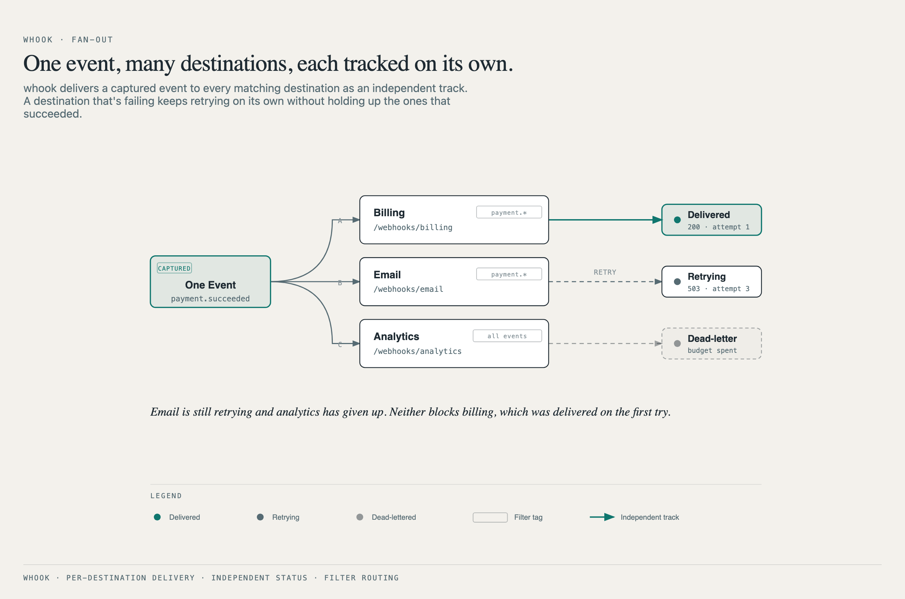

# whook

A self-hostable webhook gateway. It sits in front of your application, captures
every inbound webhook the moment it arrives, returns a fast 2xx so the provider
is happy, and then forwards the event to one or more destinations with automatic
retries. You can list, inspect, and replay any captured event.



## The problem

Services like Stripe, GitHub, and Shopify notify you about things that happen by
sending an HTTP POST to a URL you give them. A payment succeeds, a pull request
opens, an order is placed, and they POST the details to your server. That POST is
the webhook.

The catch is that the POST arrives exactly once, at a moment you do not control,
and pointing a provider straight at your application is fragile:

- If your app is down, deploying, or briefly crashing when the webhook lands, the
  event is lost. Many providers retry weakly or not at all, so a "payment
  succeeded" or "new order" event silently disappears and your data drifts from
  reality.
- When processing fails, the original request is already gone. There is no record
  of what the provider actually sent, so debugging is blind.
- A provider usually allows only one destination URL, but several internal
  services may need the same event (billing, email, analytics). That forces
  hand-written glue to receive it once and fan it out.
- There is no simple way to replay a past webhook to reproduce a bug or recover a
  missed event.

## Why a gateway helps

Instead of pointing the provider at your app, you point it at the gateway. The
gateway owns the inbound webhook end to end:

1. It saves every request to disk the instant it arrives, then immediately tells
   the provider "got it." The event is safe even if your app is down.
2. It forwards the saved event to your app on its own schedule. If your app is
   unreachable, it waits and retries with growing backoff until it succeeds or
   gives up and sets the event aside in a dead-letter pile.
3. It can forward one event to many destinations, each tracked on its own.
4. It keeps a durable copy of every request so you can list, inspect, and replay
   anything that came in.

Hosted products solve this, but they cost money and you hand them your traffic.
The open-source options mostly cover the opposite direction (sending webhooks to
your own customers). whook is for the receiving side, and you run it yourself.

## How it works

An inbound request is saved to durable storage before it is acknowledged.
Delivery happens afterward, on whook's own schedule, with retries, dead-lettering,
and replay.


A failed delivery is retried with exponential backoff until an attempt succeeds
or the retry budget is exhausted and the event is dead-lettered for inspection
and replay.


One captured event fans out to every matching destination as an independent
delivery track, each with its own status. A failing destination never blocks the
others.



## Stack

- Go, single static binary
- SQLite for storage (pure-Go driver, no cgo)
- Standard library HTTP, server-rendered UI
- dbmate for migrations

## Run with Docker

```sh
cp .env.example .env   # set WHOOK_ADMIN_TOKEN and WHOOK_SECRET_KEY
docker compose up --build -d
```

The gateway listens on `http://localhost:8080`. Data persists in the
`whook-data` volume.

## Run locally

```sh
go build ./...
go test ./...
go run ./cmd/whook
```

It defaults to a SQLite file (`whook.db`) in the working directory.

## Configuration

All settings come from environment variables.

| Variable | Default | Purpose |
| --- | --- | --- |
| `WHOOK_ADDR` | `:8080` | HTTP listen address |
| `WHOOK_DATABASE_URL` | `file:whook.db?...` | SQLite DSN |
| `WHOOK_ADMIN_TOKEN` | empty | Bearer token for the management API and dashboard. Empty disables auth (local only) |
| `WHOOK_SECRET_KEY` | empty | Passphrase to encrypt provider signing secrets at rest |
| `WHOOK_MAX_BODY_BYTES` | `1048576` | Max inbound body size; larger is rejected with 413 |
| `WHOOK_WORKERS` | `4` | Concurrent delivery workers |
| `WHOOK_POLL_INTERVAL` | `1s` | How often workers poll the queue |
| `WHOOK_RETENTION_AGE` | empty | Delete received events older than this (e.g. `720h`). Empty disables pruning |
| `WHOOK_FAILED_RETENTION_AGE` | = retention | Keep rejected and dead-lettered events longer |
| `WHOOK_PRUNE_INTERVAL` | `1h` | How often the pruner runs |

## Quick start

```sh
# 1. Register a source (the provider integration)
curl -X POST localhost:8080/sources -d '{"name":"stripe"}'

# 2. Point it at one or more destinations
curl -X POST localhost:8080/destinations \
  -d '{"source":"stripe","url":"https://your-app.example.com/webhooks"}'

# 3. Send a webhook to the gateway
curl -X POST localhost:8080/ingest/stripe \
  -H 'Content-Type: application/json' \
  -d '{"type":"payment.succeeded","amount":4900}'

# 4. Inspect captured events
curl localhost:8080/events
```

Open `http://localhost:8080/ui` for the dashboard. With an admin token set,
pass it as `Authorization: Bearer <token>` (or `?token=` for the dashboard).

## HTTP API

| Method & path | Purpose |
| --- | --- |
| `POST /ingest/{source}` | Capture an inbound webhook (public) |
| `GET /healthz` | Liveness check (public) |
| `GET /metrics` | Prometheus metrics (ingest, delivery, dead-letter) |
| `GET /events` | List captured events |
| `GET /events/{id}` | Event detail with per-destination delivery state and attempt history |
| `POST /events/{id}/replay` | Re-deliver an event (optional `?destination_id=`) |
| `GET /deadletters` | List deliveries that exhausted their retry budget |
| `GET/POST /sources`, `PATCH /sources/{name}` | Manage sources |
| `GET/POST /destinations`, `PATCH /destinations/{id}` | Manage destinations |

The dashboard at `/ui` lists events, links to a per-event detail page (payload,
delivery state, attempt history, replay button), and has a dead-letter view.
