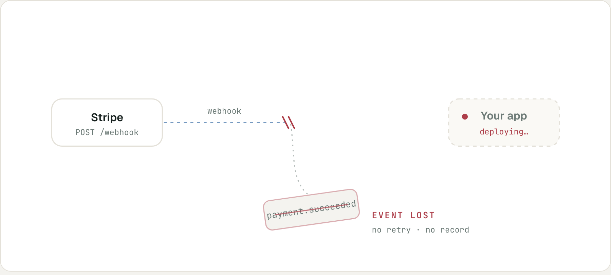

<div align="center">

# whook

**A self-hostable gateway that captures, retries, and replays inbound webhooks.**

[](https://github.com/edaywalid/whook/actions/workflows/ci.yml)
&nbsp;
&nbsp;
&nbsp;[](https://whook-gateway.netlify.app)

[Live demo](https://whook-gateway.netlify.app) · [Quick start](#quick-start) · [How it works](#how-it-works) · [HTTP API](#http-api) · [Self-host](#run-with-docker)

</div>

<br />

whook sits in front of your application. Providers point at it instead of at you.
It captures every inbound webhook the instant it arrives, returns a fast 2xx so
the provider is happy, then forwards the event to one or more destinations with
automatic retries. Every request is stored durably, so you can list, inspect, and
replay anything that came in.


**What you get**

- Durable capture before the provider is acknowledged, so no event is ever lost.
- Exponential-backoff retries with a budget, then dead-letter for what never lands.
- Fan-out to many destinations, each with its own filter, retries, and status.
- A durable record of every request, queryable and replayable from an API or UI.
- Pluggable signature verification (Stripe, GitHub), idempotent capture, metrics.
- One static Go binary. SQLite built in, Postgres when you outgrow it.

## The problem

Services like Stripe, GitHub, and Shopify notify you by sending an HTTP POST to a
URL you give them. A payment succeeds, a pull request opens, an order is placed,
and they POST the details to your server. That POST is the webhook, and it arrives
exactly once, at a moment you do not control.

Point a provider straight at your application and it is fragile:

- If your app is down, deploying, or briefly crashing when the webhook lands, the
  event is lost. Many providers retry weakly or not at all.
- When processing fails, the original request is already gone, so debugging is blind.
- A provider usually allows one destination URL, but billing, email, and analytics
  may all need the same event, which forces hand-written fan-out glue.
- There is no simple way to replay a past webhook to reproduce a bug or recover.



## How it works

Capture is decoupled from delivery. An inbound request is saved durably **before**
it is acknowledged. Delivery happens afterward, on whook's own schedule, so a
destination being down never costs you an event.


### Reliable delivery

A failed delivery is retried on a deterministic exponential schedule (a 429 honors
its `Retry-After`). When the retry budget is exhausted the delivery is dead-lettered,
so it stops consuming resources and becomes visible for inspection and replay.


### Fan-out

One captured event resolves to every matching destination as an independent delivery
track, each with its own filter and status. A failing destination never blocks the
others.


## Quick start

```sh
# 1. Register a source (the provider integration)
curl -X POST localhost:8080/sources -d '{"name":"stripe"}'

# 2. Point it at one or more destinations
curl -X POST localhost:8080/destinations \
  -d '{"source":"stripe","url":"https://your-app.example.com/webhooks"}'

# 3. Send a webhook to the gateway
curl -X POST localhost:8080/ingest/stripe \
  -H 'Content-Type: application/json' \
  -d '{"type":"payment.succeeded","amount":4900}'

# 4. Inspect captured events
curl localhost:8080/events
```

Open `http://localhost:8080/ui` for the dashboard: it lists events, links to a
per-event detail page (payload, delivery state, attempt history, replay button),
and has a dead-letter view. With an admin token set, pass it as
`Authorization: Bearer <token>` (or `?token=` for the dashboard).

## Run with Docker

```sh
cp .env.example .env   # set WHOOK_ADMIN_TOKEN and WHOOK_SECRET_KEY
docker compose up --build -d
```

The gateway listens on `http://localhost:8080`. Data persists in the `whook-data`
volume.

## Run locally

```sh
go build ./...
go test ./...
go run ./cmd/whook
```

It defaults to a SQLite file (`whook.db`) in the working directory.

## Configuration

All settings come from environment variables.

| Variable | Default | Purpose |
| --- | --- | --- |
| `WHOOK_ADDR` | `:8080` | HTTP listen address |
| `WHOOK_DATABASE_URL` | `file:whook.db?...` | SQLite DSN |
| `WHOOK_ADMIN_TOKEN` | empty | Bearer token for the management API and dashboard. Empty disables auth (local only) |
| `WHOOK_SECRET_KEY` | empty | Passphrase to encrypt provider signing secrets at rest |
| `WHOOK_MAX_BODY_BYTES` | `1048576` | Max inbound body size; larger is rejected with 413 |
| `WHOOK_WORKERS` | `4` | Concurrent delivery workers |
| `WHOOK_POLL_INTERVAL` | `1s` | How often workers poll the queue |
| `WHOOK_RETENTION_AGE` | empty | Delete received events older than this (e.g. `720h`). Empty disables pruning |
| `WHOOK_FAILED_RETENTION_AGE` | = retention | Keep rejected and dead-lettered events longer |
| `WHOOK_PRUNE_INTERVAL` | `1h` | How often the pruner runs |

## HTTP API

| Method & path | Purpose |
| --- | --- |
| `POST /ingest/{source}` | Capture an inbound webhook (public) |
| `GET /healthz` | Liveness check (public) |
| `GET /metrics` | Prometheus metrics (ingest, delivery, dead-letter) |
| `GET /events` | List captured events |
| `GET /events/{id}` | Event detail with per-destination delivery state and attempt history |
| `POST /events/{id}/replay` | Re-deliver an event (optional `?destination_id=`) |
| `GET /deadletters` | List deliveries that exhausted their retry budget |
| `GET/POST /sources`, `PATCH /sources/{name}` | Manage sources |
| `GET/POST /destinations`, `PATCH /destinations/{id}` | Manage destinations |

## Stack

- Go, single static binary
- SQLite for storage (pure-Go driver, no cgo); Postgres-ready storage interface
- Standard library HTTP, server-rendered dashboard
- dbmate for migrations
- Landing page in `web/` (TanStack Start, deployed at [whook-gateway.netlify.app](https://whook-gateway.netlify.app))

## License

MIT
